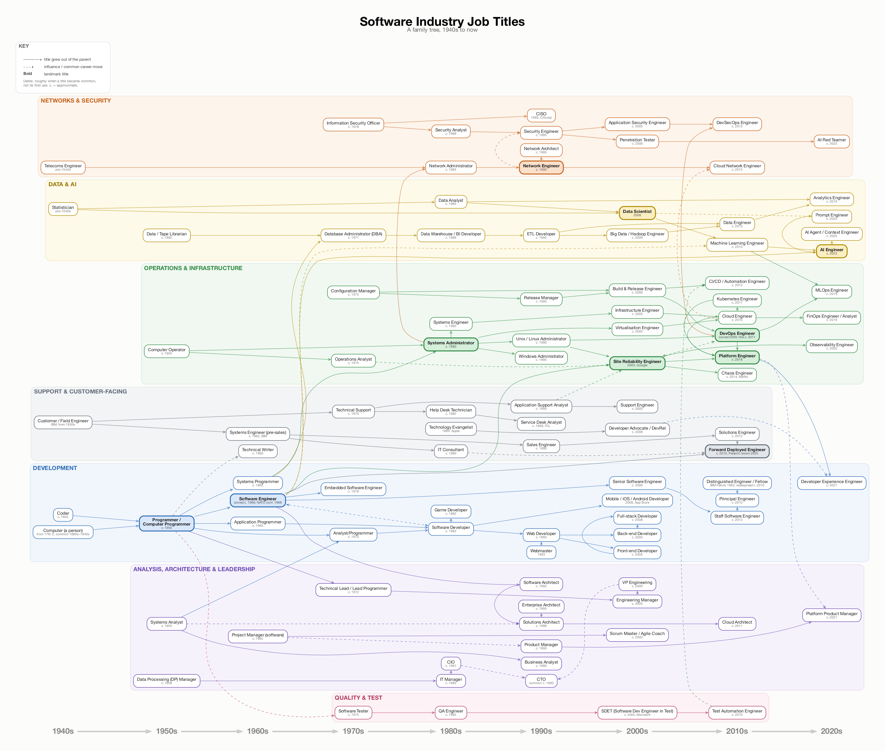

# Software industry job title family tree

A Graphviz family tree of software industry job titles, from the 1940s
("Computer", "Coder", "Programmer") to the present (SRE, Platform Engineer,
Forward Deployed Engineer, AI Engineer).



- Each title carries a date, and sits in a decade column: roughly when the
  title became common, not its first recorded use. "c." means approximate;
  exact years are given where well known (e.g. SRE at Google, 2003; "DevOps"
  coined 2009; "Data Scientist" 2008). They are best estimates, not sourced
  citations, so corrections are welcome.
- Solid arrow: the title grew out of its parent. Dashed arrow: influence or a
  common career move.
- Titles sit in coloured bands by family: development; analysis, architecture
  and leadership; operations and infrastructure; networks and security;
  data and AI; quality and test; support and customer-facing. Arrows take
  the colour of the family they lead into, and landmark titles are bold.

## Rendering

```sh
dot -Tsvg job_title_family_tree.dot -o job_title_family_tree.svg
dot -Tpng -Gdpi=110 job_title_family_tree.dot -o job_title_family_tree.png
```

Each title is one node line in `job_title_family_tree.dot`; its era is set
in the `rank=same` blocks and its parents in the lineage section.
