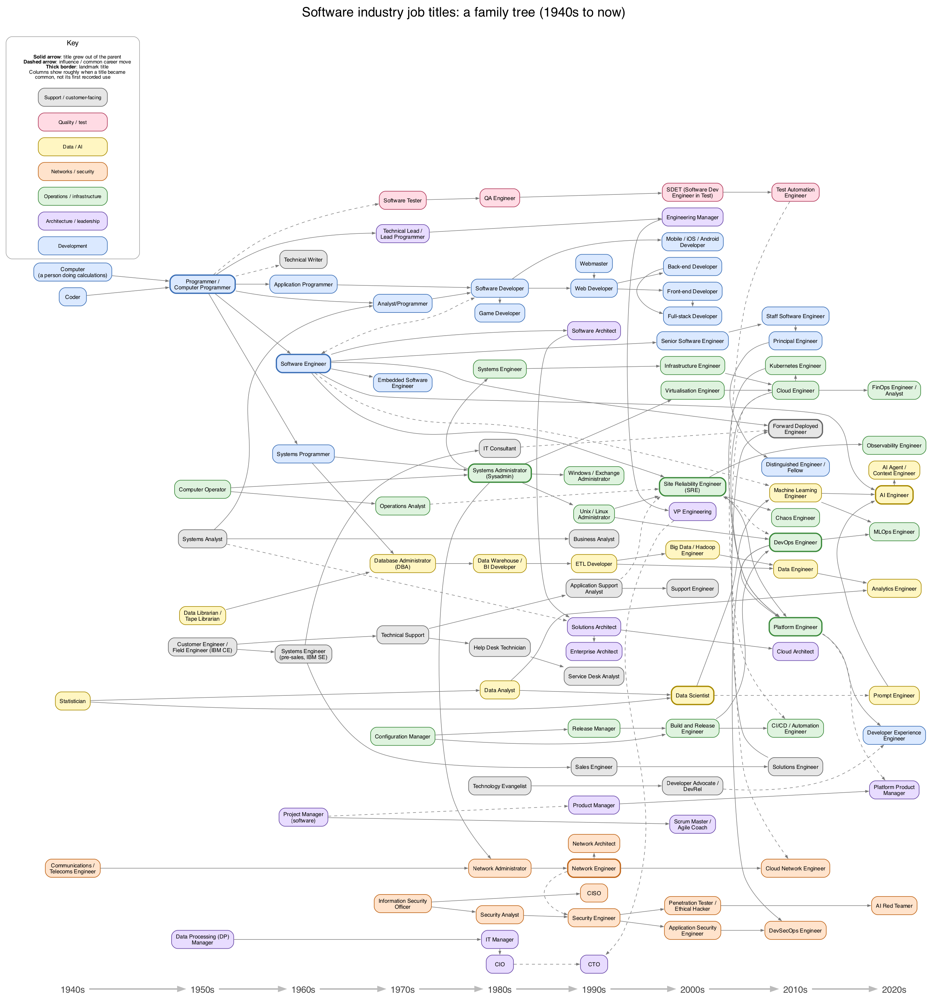

# Software industry job title family tree

A Graphviz family tree of software industry job titles, from the 1940s
("Computer", "Coder", "Programmer") to the present (SRE, Platform Engineer,
Forward Deployed Engineer, AI Engineer).

**View it: https://ianmiell.github.io/sw-job-title-family-tree/** (zoomable; click a family,
or use the buttons, to show just that column, e.g. [Data & AI](https://ianmiell.github.io/sw-job-title-family-tree/#data);
click a title for its history, background and connections, e.g. [SRE](https://ianmiell.github.io/sw-job-title-family-tree/#sre))



- Time runs from top to bottom. Each title carries a date and sits in the row
  for its five-year period: roughly when the title became common, not its first recorded use. "c." means approximate;
  exact years are given where well known (e.g. SRE at Google, 2003; "DevOps"
  coined 2009; "Data Scientist" 2008). They are best estimates, not sourced
  citations, so corrections are welcome.
- Solid arrow: the title grew out of its parent. Dashed arrow: influence or a
  common career move.
- Titles sit in coloured columns by family: development; analysis, architecture
  and leadership; operations and infrastructure; networks and security;
  data and AI; quality and test; support and customer-facing. Arrows take
  the colour of the family they lead into, and landmark titles are bold.

## Rendering

```sh
dot -Tsvg job_title_family_tree.dot -o job_title_family_tree.svg
dot -Tpng -Gdpi=110 job_title_family_tree.dot -o job_title_family_tree.png
```

Each title is one node line in `job_title_family_tree.dot`; its row is set
in the `rank=same` blocks (one per five-year period) and its parents in the lineage section.

Each title's description (shown when you click it on the site) is in `descriptions.json`,
keyed by its node id: `about` for its history and background, `links` for how it connects to
its neighbours. The lists of related titles in the panel are built from the graph's edges.

## Languages / Translations

The site is in English by default. Add `?lang=tr` for Turkish, e.g.
[`?lang=tr#sre`](https://ianmiell.github.io/sw-job-title-family-tree/?lang=tr#sre); the
EN / TR switch in the header keeps your place (`#sre`, `#data`). Nothing extra is fetched
for English, and anything a translation does not cover falls back to English.

Each language lives in `i18n/<lang>/`:

- `strings.json`: the page text (`ui`, keyed by the English string), family names
  (`families`, keyed by family id), the chart's own text such as band headings, decades and
  the key (`svg`, keyed by the English text), and each box's title and date (`nodes`, keyed
  by node id; use `\n` to split a title over the box's lines, never more lines than the
  English has). Boxes are redrawn at runtime, so the Graphviz output is untouched; a line
  wider than its box is squeezed to fit.
- `descriptions.json`: the same keys as `descriptions.json` (`about`, `links`), translated.
  A missing entry or field shows the English one.

To add a language, copy `i18n/tr/` to `i18n/<lang>/`, translate the values, and add its
code to the `LANGS` list in `index.html` so it gets a button in the header.
